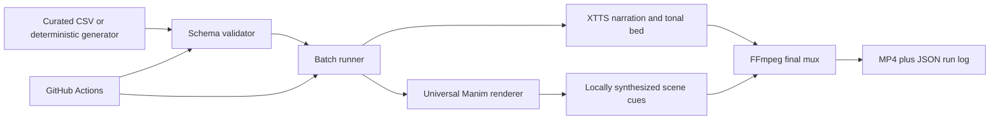

# Video Engine Architecture

**Status date:** 2026-10-14
**Purpose:** Describe what is implemented now and what is proposed next. This document is the current architecture source of truth. [FUTURE_ARCHITECTURE.md](FUTURE_ARCHITECTURE.md) is a deeper proposal; [ARCHIVE.md](ARCHIVE.md) is a historical v2.2 snapshot.

## Scope and terminology

The repository is a data-driven educational video pipeline, not a trained physics model or an autonomous LLM platform. Its "engines" are numerical and visual modules that compute or draw specific phenomena. The currently integrated generative ML model is XTTS-v2 for reference-conditioned narration. Topic generators are deterministic Python programs; no LLM or retrieval system currently writes or verifies physics content.

## Implemented System



### 1. Content and CSV contract

- `content_batch.csv` is the default production input. `--csv` selects another batch.
- `tools/generate_feynman_series.py` writes a reproducible 20-row set: ten horizontal shorts and ten paired vertical lectures.
- `tools/generate_topic_bundle.py` writes short, lecture, or both for a supplied topic and problem. Its falling-energy path only calculates $mgh$ when mass and drop height are explicitly parseable; other topics use a general explanation scaffold.
- Rows contain required identity, title, equations, visual JSON, narration, and orientation fields. Optional `beats_json` focuses animation beats by visual ID; `target_duration_sec` is a narration-pacing validation hint, not a hard render duration.
- The validator checks required columns, JSON structure, primitive names, focus IDs, duplicate IDs, orientation bounds, PYQ structure, and duration-aware narration length.

`schema_validator.py` is standard-library-only so it can run before installing Manim or TTS dependencies. A passing schema check verifies structure, not physics correctness.

### 2. Orchestration

`batch_runner.py` is the synchronous job coordinator. It selects CSV rows, filters by ID and format, chunks jobs for CI, retries failures, optionally makes silent audio for previews, calls the renderer, muxes media with FFmpeg, and writes run logs.

The default duration source is the synthesized voice WAV. The optional duration override supersedes it. A CSV duration value guides script validation but does not force the final video length.

### 3. Rendering and visual engines

`render_universal.py` interprets each row's JSON and renders Manim scenes in horizontal or vertical orientation. It supports story beats, titles, equation cards, transitions, branding, and a wide catalog of 2D/3D and self-animated primitives.

Domain modules currently routed by the renderer:

| Module | Implemented responsibility |
|---|---|
| `calculus_engine.py` | Safe expression parsing and function, derivative/tangent, integral-area, and Riemann-sum visuals. |
| `electromagnetics_engine.py` | Numeric Coulomb electric fields, finite-wire Biot-Savart fields, and synchronized plane-wave visuals. |
| `geometry_engine.py` | Dimension-checked 1D/2D/3D geometry builders and rigid translation/rotation updates. |
| `linear_algebra_engine.py` | 2D/3D vector arithmetic, dot/cross products, numeric determinants, and 2D vector/area diagrams. |
| `physics_simulation.py` | Deterministic 2D Newtonian integration using RK4, with uniform acceleration, drag, springs, and central gravity. |
| `visual_kit.py` | Camera emphasis, callouts, reveals, spotlighting, and transitions. |

The main renderer also owns specialized visual primitives such as falling-energy transfer, pendulums, orbit, projectile motion, random walks, momentum exchange, waves, and interference. `sound_design.py` produces local transition and emphasis cues.

### 4. Audio and output

When `saem_voice_sample.wav` is available, `generate_audio.py` synthesizes reference-conditioned XTTS-v2 narration and creates a quiet tonal bed. The renderer contributes cue audio to its raw movie; `batch_runner.py` mixes voice, bed, and cues and writes H.264/AAC output under `output_shorts/`.

When the voice sample is absent, local rendering fails unless `--skip-audio` is selected. GitHub Actions selects that tested silent-preview path automatically when the sample is absent; it does not create narrated audio in that case. `soundscape.py` contains mastering utilities but is not currently called by the batch runner.

### 5. GitHub Actions

`.github/workflows/render_shorts.yml` runs on relevant pushes to `main` and supports manual dispatch. It can select the production CSV or 20-row example, accept a topic and problem for deterministic bundle generation, validate the CSV, and render four shards. Rendered outputs and run logs are uploaded as artifacts.

The checked-in workflow is YAML-validated and locally exercised through CLI dry-runs. A successful local check is not the same as a completed GitHub-hosted render job.

## Model Boundaries

| Model/system | Present status | Not currently provided |
|---|---|---|
| XTTS-v2 | Used for speech when the reference WAV and dependencies are available. | No voice sample is stored as a public repo asset; Actions uses silent preview if absent. |
| Topic/problem generator | Deterministic templates and a narrow falling-energy calculation. | No general-purpose physics solver or open-ended content LLM. |
| Physics numerical modules | Validated calculations for their documented domains. | They do not automatically infer which law applies to arbitrary natural-language problems. |
| Video renderer | Executes declared visuals, equations, beats, and narration. | It does not judge factual accuracy or guarantee pedagogical quality. |
| Retrieval / knowledge base | Not implemented. | No source-grounded retrieval, citation store, or prerequisite graph. |
| Upload / analytics | Not implemented in this repo. | No automatic publishing, platform syndication, or audience-feedback loop. |

## Proposed Future Architecture

The order below is intentional: establish trustworthy content before adding model autonomy or scaling infrastructure.

### Stage A — Make content traceable

Add a small versioned concept catalog with source references, assumptions, equations, prerequisite links, and verified worked examples. Keep it structured and reviewable. Do not ingest copyrighted source text wholesale; store short references and original explanations instead.

### Stage B — Add reviewed model-assisted authoring

Add an optional planner/writer that returns schema-constrained JSON for a storyboard, script, equations, and visual IDs. Ground it in the concept catalog. Gate publication on automated unit/calculation checks where possible and human review for assumptions, accuracy, clarity, and visual fit. Never trust a fluent generated answer without verification.

### Stage C — Expand composition with tests

Continue adding domain visuals behind explicit primitive contracts. For each new primitive, add input validation, frame-safe examples, renderer routing, validator registration, and a small builder/update regression. Prefer composing existing primitives before inventing new ones.

### Stage D — Improve production reliability

Measure render time, TTS duration, retry rates, and output failures. Wire voice mastering into the active audio path and test loudness/synchronization. Consider a renderer backend interface or external compute only when GitHub Actions is an observed bottleneck; do not add a distributed orchestrator pre-emptively.

### Stage E — Add human-reviewed distribution

Only after content review and media QA are repeatable, add manual-approval publishing, then analytics ingestion. Keep API credentials outside the repository and pause automation when factual, rendering, or audio checks fail.

## Quality Gates

1. Validate every CSV before rendering; test new generators against the checked-in output.
2. Verify equations, units, signs, assumptions, and numeric answers independently of generated narration.
3. Build every referenced primitive and focus ID; inspect representative frames in both aspect ratios.
4. Check final media streams, duration, audio/video synchronization, and loudness before publishing.
5. Require human approval before public release.
6. Keep private voice assets and publishing credentials out of public source history.

## Verification Commands

```bash
python3 schema_validator.py examples/feynman_20_video_batch.csv
python3 batch_runner.py --csv examples/feynman_20_video_batch.csv --dry-run --format both
python -m pytest -q
```
